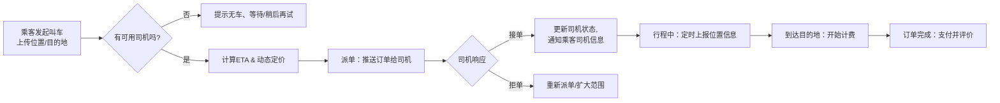

# StarX-Car

2026数据库课程设计-网约车

## 核心功能

乘客：
-   登录注册
-   选择上车地点和目的地
-   发起即使/预约叫车
-   行程中查看进度
-   支付
-   评价

司机：
-   登录注册
-   接单
-   行程中实施导航/跳转高德地图导航
-   管理收入

系统：
-   派单
-   调控司机
    - 拒单过多时提醒/惩罚
    - 强制派单
-   预约单定时任务

## 打车业务流程

## 派单逻辑

维护一个订单池，订单池有地域标识，初期仅一个，后期可扩展  
订单可要求司机评分？先置空

派单时，优先给*优先级*高的k个司机，m秒内无响应，扩大到2k个...
> 优先级计算可调整、扩展，
> 初期为 *评分 + 100/路程时间*