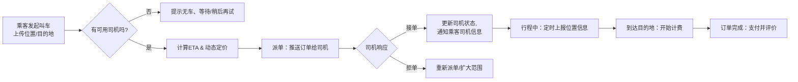

# StarX-Car

2026数据库课程设计-网约车

## 数据库课程设计报告

2026-10-05 按课程模板修订了 Word 报告，交付文件保存在本机桌面的“数据库课设报告”目录，文件名为 `StarX-Car数据库课程设计报告_修订版_班级_学号_姓名.docx`，原报告和模板保留。

报告正文统一采用学生课程设计报告表述，已清理修改过程和写作提醒类措辞，技术约束与测试完成状态如实保留。

- 按模板组织系统概述、需求分析、系统设计、系统实现、系统测试和总结；数据库设计明确分为概念设计、逻辑设计、物理设计。
- 包含核心实体联系总图、实体属性图、身份与车辆、订单、计价与位置、余额支付、投诉运营等 ER 子图，以及架构图和订单状态图；2026-10-16 补充了 10 张乘客端、司机端和管理端实际运行截图。
- 对照 `StarX-Car-Backend/create_sql.md` 描述全部 22 张表、241 个字段、关系模式、主外键、唯一约束、关键索引和数据库/应用层完整性分工。
- 报告的实时通信按 WebSocket 设计表述；本次仅修订文档，不代表已将仓库中的轮询实现改为 WebSocket。
- 保留 2026-10-05 的 125 项后端隔离测试通过记录；2026-10-16 使用现有测试账号完成下单、接单、尾号核验、结算和评价，并对同一订单的数据库事件、费用、支付及余额账本进行只读核对。真实并发、异常回滚、WebSocket 专项联调及性能测试仍单独标明待验证。
- 联调订单 `O2026101622515750400000` 最终结算 8.40 元，乘客余额 281.60→273.20 元、司机收入余额 199.40→207.80 元，费用明细和支付记录一致。应用运行时加载后端配置，未直接读取或展示 `.env`。

## 核心功能

乘客：
-   登录注册
-   选择上车地点和目的地
-   发起即使/预约叫车
-   行程中查看进度
-   支付
-   评价

司机：
-   登录注册
-   接单
-   行程中实施导航/跳转高德地图导航
-   管理收入

系统：
-   派单
-   调控司机
    - 拒单过多时提醒/惩罚
    - 强制派单
-   预约单定时任务

## 打车业务流程

## 派单逻辑

维护一个订单池，订单池有地域标识，初期仅一个，后期可扩展  
订单可要求司机评分？先置空

派单时，优先给*优先级*高的k个司机，m秒内无响应，扩大到2k个...
> 优先级计算可调整、扩展，
> 初期为 *评分 + 100/路程时间*

## 实体

User -> Passenger, Driver, Admin
Car
Order
Comment
OrderPool
City

User:
-   id (primary key)
-   username (not null, unique)
-   password (hashed)
-   gender
-   email (unique)
-   type (enum: PASSENGER, DRIVER, ADMIN)
-   create_time
-   last_login_time

Passenger:
-   id (primary key, foreign key to User)
-   phone_number (not null)
-   phone_tail (not null, generated from phone_number)
-   display_phone (not null, generated from phone_number)

Driver:
-   id (primary key, foreign key to User)
-   phone_number (not null)
-   license_number (not null)
-   rating (default 5.0)
-   car_id (foreign key to Car)
-   display_phone (not null, generated from phone_number)

Admin:
-   id (primary key, foreign key to User)

- Car:
-   id (primary key)
-   license_number (not null)
-   car_number (not null)
-   car_type (not null)
-   brand (not null)
-   color (not null)
-   create_time
-   last_update_time
