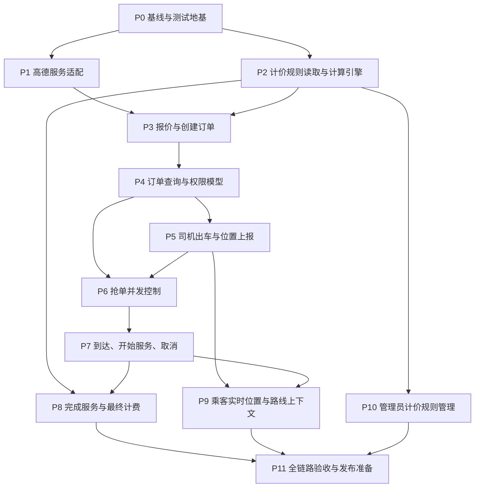

# 后端开发计划

> 更新日期：2026-08-04  
> 范围：即时叫车一期后端。涵盖计价规则、预估、下单、抢单、行程状态、HTTP 实时位置与管理员计价规则管理；不包含预约单、自动派单、支付、评价、收入结算、轨迹回放和 WebSocket。  
> 数据库基线：以 [create_sql.md](./create_sql.md) 中已初始化的表为准。执行任一数据库结构、索引或数据变更前，必须先与用户确认。

## 1. 已确认的业务边界

| 项目 | 一期决定 |
| --- | --- |
| 订单类型 | 仅即时叫车；不接受预约时间。 |
| 坐标 | 高德 GCJ-02；客户端上报和接口返回均为 GCJ-02。Android 原始 GNSS 坐标必须由客户端转换后再上报。 |
| 接单 | 司机抢单；不做自动派单。 |
| 位置 | 司机 HTTP 定时上报，乘客 HTTP 轮询最新位置；仅保存每名司机最新一条位置。 |
| 路线展示 | 服务开始后，乘客以“司机最新位置 -> 目的地”调用高德路线规划展示规划路线；后端不保存或返回行驶轨迹。 |
| 计费距离 | 下单时由后端调用高德驾车路径规划取得，并写入 `billing_distance_m`；一期不以轨迹累积距离结算。 |
| 支付 | 不实现支付，`payment_status` 固定为 `unpaid`。 |
| 取消 | 乘客可在 `PENDING` 取消；`ACCEPTED` 时乘客和接单司机均可取消；到达后不可取消。 |
| 完成 | 仅 `IN_SERVICE` 的接单司机可以完成；完成时结算时间费、等待费并生成明细。 |

默认已初始化规则：起步 5 元（含 2 km）；2--12 km 为 3 元/km，超过 12 km 为 1.2 元/km；行程前 30 分钟 0.2 元/min，之后 0.5 元/min；到达后前 5 分钟等待免费，之后 0.5 元/min。各分段遵循左闭右开区间，按规则的 `rounding_mode`（当前为 `CEIL`）计费。

## 2. 实施总览与依赖

各编号为一个可单独提交、部署和验收的工作包。除 P0 外，后续工作包只在其列出的依赖包已通过验收后启动。任何工作包发现表字段或索引不足时，应暂停在“数据库变更提案”，获得确认后才修改 `create_sql.md` 和线上数据库。

## 3. 通用交付约束

每个工作包都必须满足以下约束，避免把可运行代码误认为可交付功能：

- 使用 `order/` 领域包组织新代码：实体和 Mapper、`request/`、`response/`、Service、Controller 各自就近放置；Controller 保持薄层，多表写入在 Service 中以 `@Transactional` 执行。
- 所有新接口都具备 `@Tag`、`@Operation`、`@ApiResponses`、受保护接口的 `@SecurityRequirement`，并在 `/v3/api-docs` 验证可见。
- 认证用户仅从 `@AuthenticationPrincipal` 和 `CurrentUser.id(...)` 获得；不得相信请求中的乘客、司机或管理员 ID。
- 用 `ResponseStatusException` 表达预期业务错误。成功响应沿用统一 `ApiResponse` 包装；不得泄露 SQL、密钥、Token、精确手机号或上游高德错误详情。
- 金额统一使用 `BigDecimal`，距离和时长使用整数米/秒；金额保留两位小数，计算过程不使用 `double`。
- 时间使用服务端 `Clock`（测试可注入固定时钟），API 序列化继续使用 `Asia/Shanghai` 的既有规范。
- SQL 面向 MySQL 5.6.50 编写；不依赖可被忽略的 `CHECK` 约束、窗口函数、CTE 或 `SKIP LOCKED`。
- 每个包完成后更新本文件进度、`README.md`、`CHANGELOG.md`，运行相应 MockMvc/Service 单测和完整 `mvnw.cmd test`。涉及数据库的手工验收只能针对经确认的测试数据，不能读取或展示 `.env`。

## 4. 工作包

### P0. 基线与测试地基（已完成：2026-08-04）

**依赖：** 无。  
**目的：** 使后续订单开发有稳定的构建、测试和代码边界，而不改变任何业务或数据库数据。

**实施内容：**

1. 阅读 `AGENTS.md`、`create_sql.md`、现有安全配置、统一异常响应和现有 Controller/测试写法。
2. 使用本机 JDK 21 和 Maven Wrapper 运行完整测试，记录基线结果与测试数量。
3. 建立订单领域的包骨架及测试辅助设施：可注入 `Clock`、认证主体构造工具、订单测试夹具。包骨架不暴露任何 HTTP 路由。
4. 明确并固化枚举：订单状态、事件类型、操作人类型、收费类型、规则状态、取整模式；Java 枚举值必须与现有 SQL 存储值完全一致。
5. 形成状态迁移矩阵，作为后续 P6--P8 的单一依据：

| 当前状态 | 操作 | 执行角色 | 目标状态 | 必写字段 |
| --- | --- | --- | --- | --- |
| `PENDING` | 创建 | passenger | `PENDING` | 订单快照、`CREATE` 事件 |
| `PENDING` | 取消 | passenger | `CANCELLED` | 取消时间、取消人、原因、`CANCEL` 事件 |
| `PENDING` | 抢单 | driver | `ACCEPTED` | 司机/车辆、接单时间、`ACCEPT` 事件 |
| `ACCEPTED` | 取消 | passenger 或已接单 driver | `CANCELLED` | 取消字段、`CANCEL` 事件 |
| `ACCEPTED` | 到达 | 已接单 driver | `DRIVER_ARRIVED` | 到达时间、`ARRIVE` 事件 |
| `DRIVER_ARRIVED` | 开始服务 | 已接单 driver | `IN_SERVICE` | 开始时间、等待秒数、`START_SERVICE` 事件 |
| `IN_SERVICE` | 完成 | 已接单 driver | `COMPLETED` | 完成时间、实际时长、金额、`COMPLETE` 事件 |

**交付物：** 编译通过的领域骨架、可复用测试辅助类、状态迁移说明。  
**验收：** 完整测试通过；应用上下文和 `/v3/api-docs` 生成通过；没有新增表、索引、数据或对外接口。  
**后续依赖：** P1、P2。

### P1. 高德地图服务适配（已完成：2026-08-04）

**依赖：** P0。  
**目的：** 由后端统一获取可信的驾车规划距离与时间，隔离高德 HTTP 协议和错误处理。

**实施内容：**

1. 在 `application.yaml` 增加受校验的命名配置前缀，例如 `amap.web-service`，包含基础地址、路线 API 路径、连接/读取超时及 `AMAP_KEY` 引用；测试 Profile 提供虚拟值。
2. 实现内部 `AmapRouteClient`，输入 GCJ-02 起终点，输出不可变的 `RouteEstimate(distanceM, durationS)`；只选择驾车路径的第一条推荐路线，并校验返回距离和时长非负。
3. 将高德异常、空路径、响应格式异常、超时映射为统一的 `503 Service Unavailable`，日志仅记录 Trace ID、HTTP 状态和受控错误类别，不记录 Key 或完整用户地点。
4. 对纬度 `[-90, 90]`、经度 `[-180, 180]`、非空起终点做服务端校验；业务坐标标注为 GCJ-02。
5. 采用 mock HTTP server 或 mock client 写单测，覆盖成功、无路径、超时、4xx/5xx、格式错误及边界坐标。

**接口影响：** 无公开接口，仅提供 P3 的内部能力。  
**验收：** 给定固定起终点可取得模拟的米/秒结果；所有上游故障返回受控 503；配置缺失时应用启动的错误信息明确且不含密钥。  
**后续依赖：** P3。

### P2. 计价规则读取与计算引擎（已完成：2026-08-04）

**依赖：** P0。  
**目的：** 将 `pricing_rule` 与 `pricing_rule_tier` 转为可测试、可审计、可复用的金额计算结果。

**实施内容：**

1. 建立规则、分段和计费明细的 Entity/Mapper；读取时按 `charge_type, sort_no` 排序，并验证规则状态、分段顺序、单位和价格合法性。
2. 实现只读规则查询服务：获取唯一 `active + is_default=1` 默认规则，以及按 ID/版本加载历史规则。未找到或找到多条默认规则均作为服务端配置错误返回 503，并记录告警日志。
3. 实现纯计算 `FareCalculator`：输入规则、计费距离、行驶秒数、等待秒数，输出基础费、每一分段的用量/计费单位/金额、各类小计和总额。计算规则必须：
   - 基础费固定为 `base_fare`；`minimum_fare` 在总额汇总后生效。
   - 距离分段只对超过 `included_distance_m` 的部分收费；即使默认种子包含 0 元的包含里程分段，也不重复收取。
   - 每个分段与使用量求交集；`range_start` 包含，`range_end` 不包含，空 `range_end` 无上限。
   - `CEIL` 为按单位向上取整；后续支持其他模式时必须显式实现，未知模式拒绝计算。
   - `WAITING_TIME` 的免费分段也生成审计明细，金额为 0。
4. 为默认规则写精确单测：2 km、2.001 km、12 km、12.001 km；30 min、30 min 1 s；5 min、5 min 1 s；零时长/零距离；最低消费和不连续/重叠分段拒绝情形。

**接口影响：** 无公开接口。  
**验收：** 默认规则的计算结果稳定可复现，明细金额总和等于总额，金额无二进制浮点误差；异常规则不可用于报价或结算。  
**后续依赖：** P3、P8、P10。

### P3. 乘客报价与创建即时订单（已完成：2026-08-05）

**依赖：** P1、P2。  
**目的：** 让已登录乘客获得服务端可信预估，并以规则和路线快照创建待抢订单。

**接口：**

| 方法 | 路径 | 角色 | 成功 | 关键失败 |
| --- | --- | --- | --- | --- |
| `POST` | `/api/orders/quote` | passenger | `200` | `400` 参数非法，`503` 路线/规则不可用 |
| `POST` | `/api/orders` | passenger | `201` | `400` 参数非法，`409` 存在未结束订单，`503` 路线/规则不可用 |

**实施内容：**

1. 定义地点请求模型（POI ID、名称、地址、GCJ-02 纬经度）和报价/下单响应模型；限制地点名称和地址长度，禁止空白名称。
2. 报价流程：加载默认激活规则，调用路线客户端，以规划距离和规划时间作为计算输入，返回规则 ID/版本、距离、时长、基础费/距离费/行程时间费、预估总价及明细；报价结果仅用于展示。
3. 下单流程在一个事务中重新加载规则并重新规划路线，不能信任客户端报价或金额；生成全局唯一、可排序的 `order_no`，写入订单路线/规则/金额快照和 `CREATE` 事件。
4. 创建前检查该乘客不存在 `PENDING`、`ACCEPTED`、`DRIVER_ARRIVED`、`IN_SERVICE` 订单。通过查询和数据库约束能力降低并发重复下单；若当前表无法可靠保证并发唯一性，先提交数据库改动方案，经确认后实施。
5. 创建时把基于规划时长的时间费写为预估值，最终完成时 P8 重新按实际时长结算并覆盖订单金额/明细；在响应中清晰标记为预估。
6. 所有接口补齐 OpenAPI 文档、校验错误、角色拒绝和响应示例。

**验收：**

- 同一输入的 mock 路线产生可验证的报价与订单路线快照；客户端提交金额不会影响结果。
- 仅乘客可调用，其他角色得到 403，未登录得到 401。
- 首次下单返回 201 和订单号；同一乘客未结束订单再次下单返回 409；订单和 `CREATE` 事件要么同时写入，要么同时回滚。

**后续依赖：** P4。

### P4. 订单查询、详情与访问控制（已完成：2026-08-05）

**依赖：** P3。  
**目的：** 为双方后续流程提供一致的订单读取模型，并将订单可见性收口到服务端。

**接口：**

| 方法 | 路径 | 角色 | 说明 |
| --- | --- | --- | --- |
| `GET` | `/api/passengers/me/orders` | passenger | 分页查询本人订单，可按状态筛选。 |
| `GET` | `/api/drivers/me/orders` | driver | 分页查询本人已接订单，可按状态筛选。 |
| `GET` | `/api/orders/{orderNo}` | passenger、driver、admin | 查询订单详情；乘客仅本人，司机仅已接订单，管理员可查。 |

**实施内容：**

1. 建立订单聚合读取 Mapper/响应模型：路线快照、状态时间线、司机和车辆必要展示信息、金额及计费明细。敏感字段只返回业务需要的脱敏号码，绝不返回密码、证件号或完整手机号。
2. 建立统一 `OrderAccessService`：按订单号解析订单，分别验证乘客所有权、司机接单所有权和管理员权限；所有状态操作必须复用它，不能散落在 Controller 内。
3. 支持严格分页：`page` 从 1 起、`size` 设置最大值，白名单解析状态筛选，默认按 `created_time DESC, id DESC` 排序。
4. 详情响应需明确金额是否为预估：`PENDING/ACCEPTED/DRIVER_ARRIVED/IN_SERVICE` 是预估，`COMPLETED` 为结算，`CANCELLED` 不产生结算金额。
5. 记录读取类接口的 MockMvc 测试：跨乘客、未接单司机、取消单、终态订单、分页边界、非法状态参数和管理员访问。

**验收：** 任何用户均不能借助订单号读取他人订单；角色可见字段符合最小必要原则；列表排序和总数稳定。  
**后续依赖：** P5、P6。

### P5. 司机出车状态与位置上报（已完成：2026-08-05）

**依赖：** P4。  
**目的：** 让可服务司机进入听单状态，并以最新 GCJ-02 位置支撑抢单和乘客查看。

**接口：**

| 方法 | 路径 | 角色 | 成功 | 说明 |
| --- | --- | --- | --- | --- |
| `PUT` | `/api/drivers/me/work-status` | driver | `200` | 设置 `offline` 或 `online`。 |
| `PUT` | `/api/drivers/me/location` | driver | `200` | 上报最新位置和设备记录时间；返回统一空成功响应。 |

**实施内容：**

1. 只允许审核通过、账号有效、有当前有效绑定车辆的司机切换 `online`；有进行中订单时不得切换 `offline`。司机接单后由服务端置为 `busy`，完成或取消后回到 `online`；客户端不可直接提交 `busy`。
2. 位置上报请求包含纬经度、可选精度/速度/朝向、设备记录时间；校验范围、非未来过远时间和数值非负。服务端补充接收时间。
3. 使用 MySQL 5.6 兼容的 upsert 或先查后更新维护 `driver_location` 一人一条；只有司机自己能写自己的行。`active_order_id` 不由客户端传入，在 P6--P8 的状态事务中更新。
4. 规定保鲜窗口（建议 30 秒）并封装为配置；后续待抢单和乘客位置查询仅使用未过期位置。窗口时长是运营参数，变更配置无需改表。
5. 为状态切换和位置上报写测试，覆盖无当前车辆、未审核、进行中订单、坐标越界、过期设备时间、重复上报更新同一记录。

**验收：** 合格司机可上线和重复覆盖上报位置；不合格司机被拒绝；请求不能伪造 `busy` 或他人的司机 ID；数据表中同一司机始终只有一条最新位置。  
**后续依赖：** P6、P9。

### P6. 待抢订单与并发抢单（已完成：2026-08-05）

**依赖：** P4、P5。  
**目的：** 为在线司机提供可抢订单，并确保同一订单不会被多名司机接走。

**接口：**

| 方法 | 路径 | 角色 | 成功 | 关键失败 |
| --- | --- | --- | --- | --- |
| `GET` | `/api/drivers/me/orders/pending` | driver | `200` | `409` 未处于可听单状态 |
| `POST` | `/api/orders/{orderNo}/accept` | driver | `200` | `409` 已被抢/司机有进行中订单/无当前车辆 |

**实施内容：**

1. 待抢列表只返回 `PENDING` 订单，排除该司机自身不存在的有效听单资格；一期可按创建时间排序，不承诺按距离排序。若需要附近订单排序，需先确认地理索引与检索方案。
2. 抢单前校验司机账号、审核状态、`work_status=online`、当前车辆存在且仍是有效绑定、司机无未结束订单。
3. 在一个事务中执行条件更新：`WHERE id = ? AND status = 'PENDING' AND driver_id IS NULL AND version = ?`，同时设置司机、当前车辆快照、接单时间、`ACCEPTED` 和 `version = version + 1`。受影响行数必须为 1。
4. 条件更新成功后写 `ACCEPT` 事件，把司机置为 `busy`，并把该司机最新位置的 `active_order_id` 设为订单 ID。任一步失败必须回滚。
5. 条件更新失败统一返回 409，提示订单状态已变化；不得先查询成功后无条件更新。
6. 写并发 Service 测试（两个线程/事务同步触发），断言只有一个成功；同时覆盖司机重复抢单、司机离线、未上报位置、无当前车辆、乘客访问拒绝。

**验收：** 两名司机同时抢同一订单时恰有一人成功，订单中的司机和车辆快照正确，成功后司机为 `busy` 并存在唯一 `ACCEPT` 事件。  
**后续依赖：** P7。

### P7. 取消、到达与开始服务（已完成：2026-08-05）

**依赖：** P6。  
**目的：** 完成行程前的受控状态转换，并可靠记录等待时间起点和开始服务时刻。

**接口：**

| 方法 | 路径 | 角色 | 成功 | 关键失败 |
| --- | --- | --- | --- | --- |
| `POST` | `/api/orders/{orderNo}/cancel` | passenger、driver | `200` | `409` 当前状态不可取消/非接单司机 |
| `POST` | `/api/orders/{orderNo}/arrive` | driver | `200` | `409` 非 `ACCEPTED` 或非接单司机 |
| `POST` | `/api/orders/{orderNo}/start-service` | driver | `200` | `409` 非 `DRIVER_ARRIVED` 或非接单司机 |

**实施内容：**

1. 所有操作从 P4 的访问服务取得订单，再用包含期望状态与 `version` 的条件更新完成迁移，避免重复请求或并发取消留下不一致状态。
2. 取消规则严格执行：乘客只能取消自己的 `PENDING` 或 `ACCEPTED`；司机只能取消自己已接的 `ACCEPTED`；`DRIVER_ARRIVED`、`IN_SERVICE` 和终态均返回 409。理由为可选字段，限制长度并转义/校验空白值。
3. 取消成功写 `cancelled_time`、`cancelled_by`、原因和 `CANCEL` 事件；若已接单，司机恢复 `online`，其 `driver_location.active_order_id` 清空。
4. 到达成功写 `driver_arrived_time` 和 `ARRIVE` 事件；开始服务成功写 `service_started_time`、以服务端时间计算的 `waiting_duration_s`（小于零视为异常）、`START_SERVICE` 事件。到达后不允许取消。
5. 对每个迁移写事务与 MockMvc 测试：正确角色、错误角色、重复调用、并发取消/到达、事件字段、司机状态恢复/保持。

**验收：** 状态矩阵之外的迁移均不可发生；每次成功转换只产生一个事件；等待时长等于服务端开始时间减服务端到达时间；取消后的已接订单释放司机。  
**后续依赖：** P8、P9。

### P8. 完成服务与最终计费（已完成：2026-08-05）

**依赖：** P2、P7。  
**目的：** 在服务完成时用订单规则快照和实际时间产生可追溯的最终金额。

**接口：**

| 方法 | 路径 | 角色 | 成功 | 关键失败 |
| --- | --- | --- | --- | --- |
| `POST` | `/api/orders/{orderNo}/complete` | driver | `200` | `409` 非 `IN_SERVICE` 或非接单司机 |

**实施内容：**

1. 在一个事务中锁定或以版本条件更新 `IN_SERVICE` 订单，取服务端当前时间作为 `completed_time`，计算 `actual_duration_s = completed_time - service_started_time`。
2. 按订单的 `pricing_rule_id + pricing_rule_version` 加载规则，而不是当前默认规则；使用 `billing_distance_m`、实际行程秒数和 P7 记录的等待秒数调用 P2 引擎。
3. 覆盖订单的基础费、距离费、行程时间费、等待费、总额和完成时间；批量写入 `order_fare_item`，每一项携带规则/版本/分段快照、实际用量、计费单位、价格、单位数和金额；写 `COMPLETE` 事件。
4. 成功后司机从 `busy` 回到 `online`，并清空 `driver_location.active_order_id`。事务失败时状态、金额、明细、事件和司机状态必须全部回滚。
5. 明确幂等策略：首次完成成功；重复完成返回 409，客户端通过订单详情获取已结算结果，不重复写金额或明细。
6. 测试默认规则的集成计价例子、历史规则不受新默认规则影响、事务回滚、重复完成、最小消费、明细相加与订单总额一致。

**验收：** 只有接单司机可完成 `IN_SERVICE` 订单；完成后恰有一组完整的计费明细和一个完成事件；数据库订单金额与明细总和一致，司机重新可听单。  
**后续依赖：** P11。

### P9. 乘客实时位置与路线上下文（已完成：2026-08-05）

**依赖：** P5、P7。  
**目的：** 使乘客在合法订单阶段获得司机的最新位置，并在服务中获得目的地路线规划所需坐标。

**接口：**

| 方法 | 路径 | 角色 | 成功 | 关键失败 |
| --- | --- | --- | --- | --- |
| `GET` | `/api/orders/{orderNo}/driver-location` | passenger | `200` | `403` 非本人，`409` 状态不可查看，`404` 无最新位置 |
| `GET` | `/api/orders/{orderNo}/route-context` | passenger | `200` | `409` 非 `IN_SERVICE` |

**实施内容：**

1. 位置接口仅限订单乘客且订单有已接司机，推荐开放 `ACCEPTED`、`DRIVER_ARRIVED`、`IN_SERVICE`；返回纬经度、精度、朝向、设备记录时间、服务端接收时间和过期标记，不返回司机完整身份或历史点。
2. `route-context` 仅在 `IN_SERVICE` 返回司机最新 GCJ-02 坐标、订单目的地坐标/名称及建议刷新阈值（100 m 或 60 s）。路线折线由 Flutter 使用高德 SDK/服务规划，后端不代理高德路线，不保存轨迹。
3. 当位置超过 P5 保鲜窗口，位置接口返回 `stale=true` 和时间戳，仍不伪造新位置；客户端据此提示并继续轮询。无位置记录与无权访问要区分状态码但不泄露订单存在性给无权用户。
4. 为 `ACCEPTED`、`DRIVER_ARRIVED`、`IN_SERVICE`、完成/取消状态、位置缺失/过期、跨乘客访问和司机/管理员拒绝写测试。
5. 在接口描述中明确推荐客户端 3--5 秒轮询，不接受客户端提交路线或位置归属。

**验收：** 乘客可在接单后轮询到其订单司机的最新 GCJ-02 坐标；服务中可取得重规划上下文；任何其他乘客都无法探测位置或订单状态。  
**后续依赖：** P11。

### P10. 管理员计价规则管理（已完成：2026-08-05）

**依赖：** P2。  
**目的：** 让管理员维护可版本化、可回退的规则，并保证进行中的订单继续使用创建时快照。

**接口：**

| 方法 | 路径 | 角色 | 说明 |
| --- | --- | --- | --- |
| `GET` | `/api/admin/pricing-rules` | admin | 分页查询规则和状态。 |
| `POST` | `/api/admin/pricing-rules` | admin | 新建草稿规则及完整分段。 |
| `GET` | `/api/admin/pricing-rules/{ruleId}` | admin | 查看规则和分段。 |
| `PUT` | `/api/admin/pricing-rules/{ruleId}` | admin | 仅更新草稿规则及分段。 |
| `POST` | `/api/admin/pricing-rules/{ruleId}/activate` | admin | 激活规则，可选择设为默认。 |
| `POST` | `/api/admin/pricing-rules/{ruleId}/archive` | admin | 归档非当前默认规则。 |

**实施内容：**

1. 定义规则写入请求，要求完整提交基础费、包含里程、最低消费和三个收费类型的有序分段；所有金额、区间、单位、排序号做 Bean Validation 和业务校验。
2. 抽取并复用 P2 的规则完整性校验：每种类型从 0 开始、无重叠、无空洞、只有最后一段可无上限、单位大于 0、价格非负、排序唯一；距离免费范围与 `included_distance_m` 的关系要明确验证。
3. 新规则初始为 `draft`，同名新版本的版本号在事务中计算。草稿更新采取“删除旧分段并插入新分段”或等价的原子替换；该操作仅可用于从未被订单引用的草稿。
4. 激活事务：将目标草稿改为 `active`；若选择默认，先将其他 `active + is_default=1` 规则改为 `inactive`/非默认，再设置目标为默认。由于 MySQL 5.6 无部分唯一索引，必须通过事务、行锁和最终一致性检查保证至多一条。
5. 已由订单引用的规则不得物理删除或改写；归档只变更适当状态，当前默认规则不能归档。规则调整不回写任何历史订单金额。
6. 覆盖权限、版本冲突、分段不合法、并发激活、默认规则唯一性、历史订单规则可读和 OpenAPI 测试。

**验收：** 管理员能创建、校验、查看、激活和归档规则；任意时刻仅一条活动默认规则；新订单使用新默认规则，旧订单保持旧规则 ID/版本和金额。  
**后续依赖：** P11。

### P11. 全链路验收、可观测性与发布准备（已完成：2026-08-05）

**依赖：** P8、P9、P10。  
**目的：** 在上线前验证一期订单闭环、接口契约和故障行为。

**实施内容：**

1. 构建测试场景：合格司机上线并上报位置、乘客报价下单、司机查单抢单、乘客轮询位置、司机到达、开始服务、乘客读取路线上下文、司机完成、双方读取账单；另建乘客取消和司机取消两个分支。
2. 在 MockMvc 层验证所有端点的成功响应、401、403、404、409、503 和统一响应信封；验证 `/v3/api-docs` 包含新端点、请求字段、响应与安全定义。
3. 用受控的测试配置验证高德超时/不可用、默认规则缺失、位置过期、并发抢单和完成事务失败；确认日志只含 Trace ID、订单号和受控状态，不含地点详情、电话、Key、JWT 或 SQL 错误。
4. 在经批准的非生产测试数据上进行最小数据库冒烟：确认表名小写、索引存在、默认规则唯一、订单事件/计费明细/最新位置的事务结果正确。不得读取 `.env`，仅允许运行时装载连接配置。
5. 执行 `mvnw.cmd test`、`mvnw.cmd clean package`，记录命令、JDK 版本和结果；启动应用后验证 Swagger UI 与 OpenAPI JSON。
6. 更新 `README.md` 的已实现能力、接口表、运行配置与未实现边界；`CHANGELOG.md` 逐项记录接口、状态机、计费语义、数据库变更（如有）、测试结果和已知限制。

**验收：** 所有 P0--P10 自动测试和完整构建通过；闭环场景可重复执行；文档与实际 OpenAPI 一致；不存在未说明的数据库变更或未解决的高风险异常。  
**后续依赖：** 一期订单后端完成，可进入客户端联调。

## 5. 接口交付顺序

为避免客户端依赖未稳定的状态语义，建议按下列批次对外联调：

| 批次 | 可交付接口 | 前置工作包 | 联调价值 |
| --- | --- | --- | --- |
| A | 无公开接口（高德、计价内部能力） | P1、P2 | 用单测锁定路线和金额语义。 |
| B | `POST /api/orders/quote`、`POST /api/orders`、乘客订单列表/详情 | P3、P4 | 乘客端可完成地点选择、报价与下单。 |
| C | 司机工作状态/位置、待抢单/已接单列表、抢单 | P5、P6 | 司机端可完成听单和抢单。 |
| D | 取消、到达、开始服务、完成 | P7、P8 | 双端可跑完整状态机与结算。 |
| E | 司机位置、路线上下文、管理员计价规则管理 | P9、P10 | 完成实时展示和运营配置。 |

## 6. 数据库变更门禁

当前计划优先复用已初始化的六张订单相关表，**不预设任何必需改表**。以下情形须先提交“变更原因、SQL 初始化写法、线上影响、回滚/兼容方案、验证 SQL”，收到确认后才能执行：

| 触发条件 | 可能的变更方向 |
| --- | --- |
| 并发下单无法由现有事务可靠限制为每位乘客仅一个未结束订单 | 增加受控锁定/索引方案，或调整创建事务。 |
| 待抢列表必须按司机距离排序且数据量超过普通筛选可承受范围 | 设计地理位置索引或检索方案。 |
| 需要行驶轨迹、争议复核或轨迹计价 | 新增轨迹历史表及留存/清理策略。 |
| 需要支付、退款或第三方对账 | 新增支付流水与幂等键表，不能复用订单状态字段替代。 |
| 规则版本审计需要不可变快照而非关联规则记录 | 新增规则快照存储，而不是修改历史规则。 |

## 7. 一期完成定义与后续候选项

一期完成的判定不是“接口存在”，而是 P11 通过且以下能力可联调：乘客能以 GCJ-02 地点获得报价并下即时单；在线合格司机可基于当前车辆抢单；双方只能执行授权的状态转换；乘客能轮询司机最新位置并在服务中获得路线上下文；完成订单产生可解释的分段账单；管理员能安全切换默认规则；所有新接口在 Swagger 中可见。

一期后再单独评审的候选项：预约单（已实现，见仓库根目录 [RESERVATION_DEVELOPMENT_PLAN.md](../RESERVATION_DEVELOPMENT_PLAN.md)）、自动派单和附近订单排序、WebSocket、完整轨迹与真实里程计费、支付/退款、评价与投诉（评价已实现）、司机收入/对账、运营优惠和动态计价、风控与审计保留策略。
